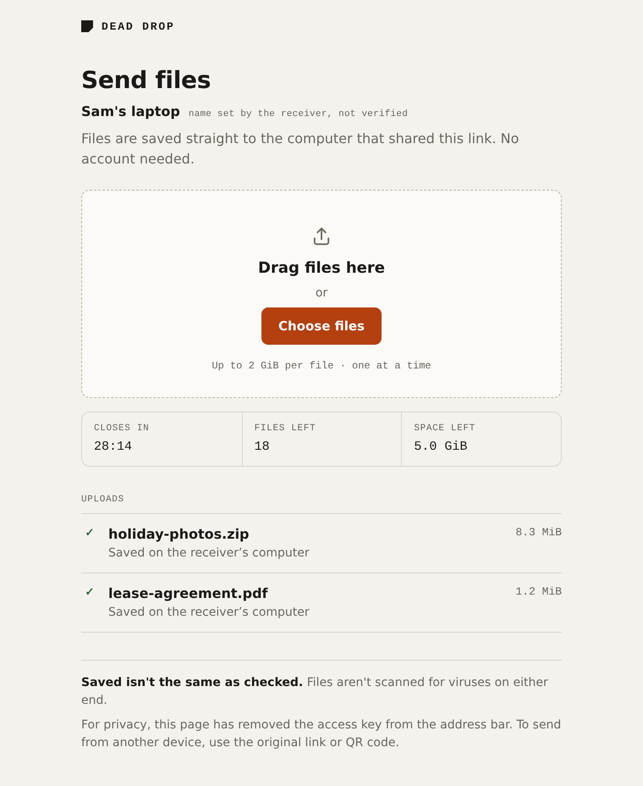

<h1 align="center">Dead Drop</h1>

<p align="center">
  Get files from someone's browser onto your computer.<br>
  No accounts, no app to install, nothing left running afterwards.
</p>

<p align="center">
  <a href="https://github.com/itsbryanman/DeadDrop/actions/workflows/ci.yml"></a>
  <a href="https://pkg.go.dev/github.com/itsbryanman/DeadDrop"></a>
  <a href="https://goreportcard.com/report/github.com/itsbryanman/DeadDrop"></a>
  
  
  <a href="LICENSE"></a>
</p>

---

Someone needs to send you a file. They're on their phone, or a borrowed
laptop, or they just don't want to sign up for anything. You run one
command, they open a link (or scan a QR code), drop the file in, and it
lands in a folder on your machine. Close the session and the link stops
working.

```
$ deaddrop receive

Dead Drop is receiving files
  Network:  Trusted LAN — HTTP, not encrypted
  Link:     http://192.168.1.25:8080/r#Xw3qDQMoLwXdJb4Srf8qMg
  Saving:   ~/Downloads/deaddrop/20261013-200655-af1a8f772f757ebe/
  Limit:    2 GiB/file, 5 GiB/session, 20 files, one upload at a time
  Expires:  30 minutes (at 20:36)

  [QR code]

Waiting for files. Press Ctrl+C to end this session.
✓ holiday-photos.zip           8.3 MiB    saved
✓ lease-agreement.pdf          1.2 MiB    saved
Session ended. Received 2 files (9.5 MiB) in ~/Downloads/deaddrop/20261013-200655-af1a8f772f757ebe
```

And this is what the person sending sees:

<p align="center">
  <picture>
    <source media="(prefers-color-scheme: dark)" srcset="docs/assets/upload-page-dark.png">
    
  </picture>
</p>

## Why

I kept running into the same small problem: getting a file from someone
else's device onto mine, right now, without making either of us create an
account or install something. Most tools that solve it are either cloud
services or full-blown file servers. I wanted something closer to `python
-m http.server` but in the other direction, and safe enough to use
without thinking too hard.

So Dead Drop is deliberately small. It does one thing. If you need a real
file server, [copyparty](https://github.com/9001/copyparty) and
[CasaDrop](https://github.com/chicohaager/casadrop) are great.

## Install

With Go 1.24 or newer:

```sh
go install github.com/itsbryanman/DeadDrop/cmd/deaddrop@latest
```

Or build from source:

```sh
git clone https://github.com/itsbryanman/DeadDrop.git
cd DeadDrop
make build        # binary ends up in ./bin/deaddrop
```

It's a single binary with the web page baked in. No config file, no
database, no background service.

## Usage

The defaults are meant to be fine most of the time:

```sh
deaddrop receive
```

A few things you might want to change:

```sh
deaddrop receive --expires 10m              # close sooner
deaddrop receive --max-file 500MiB          # smaller per-file cap
deaddrop receive --dir ~/Desktop/inbox      # save somewhere else
deaddrop receive --name "Sam's laptop"      # title shown on the page
```

<details>
<summary><b>All flags</b></summary>

```
deaddrop receive [flags]

  --dir PATH              Destination base (default ~/Downloads/deaddrop)
  --expires DURATION      Session lifetime, e.g. 10m or 2h (default 30m, max 24h)
  --max-file SIZE         Per-file limit (default 2GiB)
  --max-total SIZE        Total for the session (default 5GiB)
  --max-uploads N         Maximum completed files (default 20)
  --port PORT             Listen port (default 8080 on LAN, random with --tunnel)
  --bind ADDRESS          Listen on this address instead of the detected LAN one
  --tunnel cloudflare     Serve over HTTPS through a Cloudflare quick tunnel
  --name TEXT             Title shown on the upload page (not verified)
  --json                  Machine-readable events, one JSON object per line
  --json-include-secret   Include the secret link in --json output
```

Sizes use binary units (`500MiB`, `2GiB`). `GB` and friends are rejected
on purpose rather than guessed at.

</details>

### When you're not on the same network

```sh
deaddrop receive --tunnel cloudflare
```

This uses [`cloudflared`](https://developers.cloudflare.com/cloudflare-one/connections/connect-networks/downloads/)
(install it first) to get a temporary `https://….trycloudflare.com`
address. Dead Drop waits until that address actually loads before it shows
you the link, and shuts `cloudflared` down when the session ends. It only
touches the `cloudflared` process it started.

### Scripting

`--json` prints one event per line: `session_started`, `upload_started`,
`upload_progress`, `upload_saved`, `upload_failed`, `warning`, `error`,
`session_ended`. The link contains the secret, so it's left out unless you
also pass `--json-include-secret`.

```sh
deaddrop receive --json | jq -r 'select(.event=="upload_saved") | .name'
```

Exit codes: `0` ended normally, `1` unexpected error, `2` bad flags,
`3` network problem (no LAN address, port taken), `4` tunnel problem,
`5` can't use the destination folder.

## What it protects, and what it doesn't

Worth reading before you use it for anything sensitive.

- **On a LAN it's plain HTTP.** Anyone who can see traffic on that network
  can see the files and the link. Fine at home, not great on café Wi-Fi.
  Use `--tunnel cloudflare` or a network you trust.
- **The tunnel is HTTPS, but not end to end.** Cloudflare terminates TLS
  and can see what passes through. Quick tunnels are also meant for
  testing and come with no uptime promise.
- **The link is the password.** It carries a 128-bit random key after the
  `#`, which browsers never send to the server. The page strips it from
  the address bar as soon as it loads. Anyone who has the link can upload
  until the session ends, so treat it like a password.
- **Nothing is scanned.** "Saved" means written to disk. Treat received
  files like any other download.
- **Your computer has to stay on** for the whole transfer.

Under the hood, uploads go into a temporary file, get flushed to disk, and
are then linked into place in a way that can never overwrite an existing
file. If a transfer is interrupted, the half-finished file is deleted. If
the process gets killed hard (power cut, `kill -9`), leftovers are reported
the next time you run it.

The full threat model is in [docs/SECURITY.md](docs/SECURITY.md).

## Development

```sh
make test     # unit + integration tests
make race     # same, with the race detector
make vet      # go vet + gofmt check
make e2e      # browser tests with Playwright (needs Node 22)
make dist     # cross-compiled binaries in ./dist
```

CI runs the tests on Linux, macOS and Windows. If you're curious how it
fits together, [docs/ARCHITECTURE.md](docs/ARCHITECTURE.md) walks through
it, and [docs/TEST-PLAN.md](docs/TEST-PLAN.md) lists what's covered and
what still needs a real phone in hand.

## Roadmap

`deaddrop send ./folder` (the other direction) is next, but only once
`receive` has proven itself with people who aren't developers. See
[docs/ROADMAP.md](docs/ROADMAP.md).

## License

[MIT](LICENSE)
